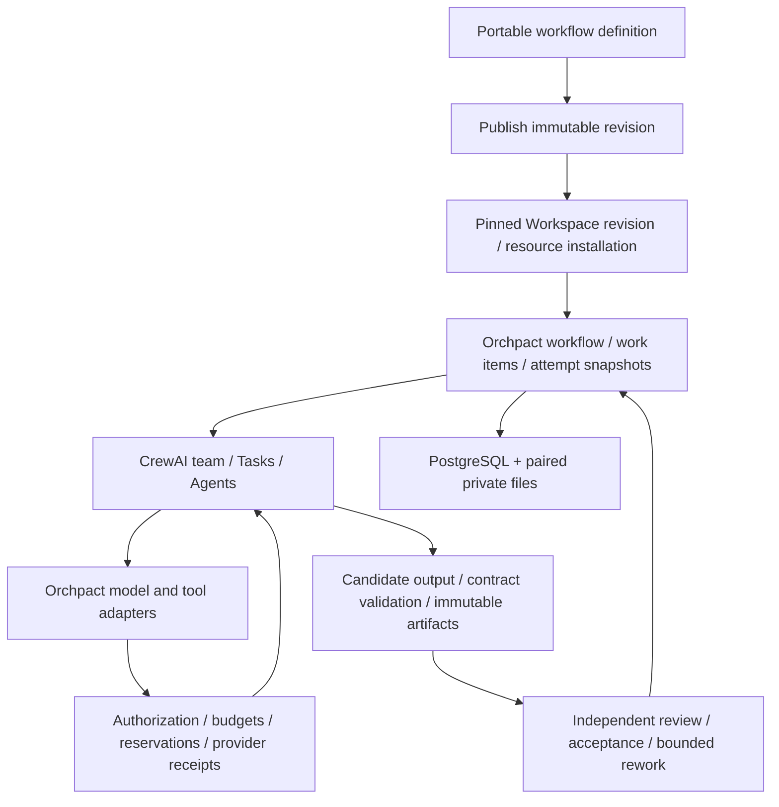

# Orchpact · 序契

[简体中文](README.md) | **English**

Suggested pronunciation (US): **/ˈɔːrk.pækt/** — **ORK-pakt**, with stress on the first syllable.

**Define the contract. Execute with agents. Verify the evidence. Accept the deliverable.**

[Website](https://orchpact.github.io/) · [Getting started](docs/GETTING_STARTED.md) · [Architecture](docs/ARCHITECTURE.md) · [Online documentation](https://orchpact.github.io/docs/)

**Orchpact is an open-source, self-hosted, contract-driven agent workflow service. CrewAI executes collaboration within teams; the platform manages artifacts, verification evidence, and acceptance.** Authors declare teams, roles, dependencies, resource requirements, delivery contracts, and acceptance rules. Consumers install those definitions in their own Workspaces, bind local model resources, and start independent runs.

Fixed execution plans and explicit delivery contracts are the recommended entry point. Assurance is limited to the declared checks and recorded evidence; structurally valid output without business verification does not establish factual correctness. Autonomous planning, recruitment, and dynamic delegation remain experimental. Organization structures, templates, and components support delivery rather than a general application-hosting or operations platform.

A workflow is a shareable asset with explicit version references. Different people, teams, and applications can use the same definition, while the service enforces access boundaries around accounts, model credentials, inputs, runs, artifacts, and accounting.

The project ships as an **HTTP service, CLI, management console, and Docker/Compose setup**. The Python wheel installs the service. Public integration boundaries are workflow JSON, HTTP APIs, HTTP clients, and the CLI. This repository contains the implementation and technical documentation; the website lives in the separate [orchpact.github.io repository](https://github.com/orchpact/orchpact.github.io). Orchpact uses the [MIT License](LICENSE).

Most linked technical guides and the website are currently in Chinese.

Start with [four executable delivery examples](examples/README.md). Run `uv run python examples/verified-delivery.py` from this repository to exercise pass, rejection, repair, and inconclusive outcomes with isolated PostgreSQL and synthetic model responses. No paid provider, child application, signing key, or gateway is required.

## Two layers of collaboration, one durable runtime



| Boundary | Orchpact | CrewAI |
| --- | --- | --- |
| Definition and installation | Published revisions, Workspace installations and resources, and execution snapshots | Creates runtime objects from the frozen team declaration |
| Coordination | Cross-team dependencies, work items, cancellation, retries, and rework | Sequential Tasks and context handoff between roles within a team |
| Autonomous action | Provides models and tools constrained by permissions, scope, and budgets | Agents choose tools, inspect observations, and act over multiple turns |
| Records and delivery | Persists provider receipts, accounting, artifacts, and acceptance records | Returns candidate results for platform validation |

**Team declarations are reusable; every actual launch creates fresh Crew, Task, and Agent objects.** A department or working group can have a team declaration, with members represented as role declarations. Runtime objects are never shared across projects, Workspaces, or retries. CrewAI follows the declared collaboration order and drives tool selection and multi-turn action within the team. Orchpact advances the cross-team business graph.

Every model and tool call passes through platform adapters. The framework cannot expand permissions, change the payer, or accept a delivery on its own. CrewAI usage summaries are not used for billing. See [responsibilities and adapter design](docs/EXECUTION_BOUNDARY.md) and [team declarations and runtime instances](docs/TEAM_EXECUTION.md).

## Publish, install, and run directly

Publish an immutable workflow revision, preview model/tool bindings, and explicitly install it in the current Workspace. Run it through `POST /api/v1/workflows/{id}/runs` with an idempotency key; query `GET /api/v1/runs/{id}`. No consuming application, key pair, or gateway is required. Publishing does not upgrade existing installations, and installation upgrades do not rewrite prior runs or bypass their idempotency keys.

The management console provides resource preview/install and direct execution on the workflow catalog page. The service still enforces Workspace membership, budgets, payer, receipts, artifacts, and acceptance. See [direct execution](docs/APPLICATIONS.md).

## Start with a team workflow

[department-review.json](examples/workflows/department-review.json) is a complete portable example:

1. The analysis team's `analyst` checks the original records. Its `writer` uses the team context to deliver `result.json`.
2. A separate review team's `checker` recomputes the result and submits `audit.json` referencing the current artifact ID.
3. Orchpact checks file contracts and review references. A rejection triggers targeted rework within the declared limit; each new artifact must be reviewed again.

For source selection followed by report writing, declare separate steps as in [explicit-reference-report.json](examples/workflows/explicit-reference-report.json). The executor does not infer extra model calls or rewrite output Schemas from citation rules. This example checks structure and citations, not factual accuracy or report quality. Execution identities cannot amend admitted plans, and user amendments cannot remove required checks, their input or aggregation paths, or existing acceptance dependencies. Changed acceptance requirements need a new definition and a new run.

Teams are declared in `units[].crew`. Nodes select participating roles and their order through `participants`; internal team collaboration does not create extra business work items. Model requirements and consumer bindings are stored separately:

```json
{"resources":{"models":{"reasoning":{"capabilities":["text","json"]}}}}
```

```json
{"models":{"reasoning":"your-text-profile"}}
```

The first block is a resource requirement fragment from the definition. The second is a local installation binding file. Keep them separate. Validate the complete example offline from the source checkout:

```sh
uv sync --frozen
uv run orchpact workflow-check examples/workflows/department-review.json
```

This step requires no instance configuration, database, or model. Once an instance is running, publish the definition in the console's workflow catalog, select an explicit `department-review` revision, preview its resource bindings, and install it in the current Workspace.

The bundled client can also perform the initial publication and Workspace installation:

```sh
# Supply ORCHPACT_API_TOKEN through the environment; bindings contain only local model IDs.
uv run python examples/register-workflow.py examples/workflows/department-review.json \
  --install --bindings /absolute/private/bindings.json
```

Use the catalog’s direct-run action or `POST /api/v1/workflows/department-review/runs` with an idempotency key, as described in [direct execution](docs/APPLICATIONS.md):

```json
{"operation":"calculate","input":{"records":[{"id":"source-a","amount":3},{"id":"source-b","amount":5}]},"context":{}}
```

An actual run calls the configured model and consumes credits. Use the platform session; administrator credentials never enter the frontend. `crew_runs` and `agent_steps` associate the run with its Crews, participating roles, runtime Agents, and model/tool steps. They follow the run's access rules and do not expose private observation bodies to callers.

For a smaller calculation-and-review definition, see [evidence-review.json](examples/workflows/evidence-review.json). Both examples use the same workflow, artifact, and acceptance mechanisms.

## Run the service

### Docker Compose

The repository provides a standalone setup for the service, console, and PostgreSQL, built from source:

```sh
git clone https://github.com/orchpact/orchpact.git
cd orchpact
python3 docker/configure.py
docker compose --env-file docker/.env config --quiet
docker compose --env-file docker/.env up -d --build --wait
```

Open `http://127.0.0.1:8780/admin/`. The generator saves random administrator credentials to the private local `docker/.env` file without printing or overwriting them. Read `ORCHPACT_API_TOKEN` locally to sign in. If the port is occupied, change `ORCHPACT_PORT` first. PostgreSQL exposes no host port, and the application uses a dedicated non-superuser database role. See [Docker operation](docker/README.md) for configuration, volume preservation, backup, and recovery.

### Python source

Requires Python 3.11–3.13, uv, and a dedicated PostgreSQL database. PostgreSQL 18 is the version used for validation and Compose.

```sh
uv sync --frozen
uv run orchpact --root /absolute/private/orchpact-instance init
# Create a dedicated empty database and set ORCHPACT_DATABASE_URL in the instance's .env.
uv run orchpact --root /absolute/private/orchpact-instance check
uv run orchpact --root /absolute/private/orchpact-instance serve --host 127.0.0.1 --port 8780
```

`init` creates private configuration with mode 600 and does not print credentials. The management interface can start without a model. Before execution, configure a usable model and allocate credits to the executing account; new accounts start with **0**. Internal credits and actual provider costs are recorded separately. See [PostgreSQL operations](docs/POSTGRESQL.md) for connection configuration and [getting started](docs/GETTING_STARTED.md) for the complete walkthrough.

## Runtime invariants

- **Authorized actions:** every model or tool action rechecks the execution identity, attempt, capabilities, deadline, budget, and stop flags. Organization hierarchy does not automatically grant delegation or acceptance rights.
- **Bounded execution:** each attempt defaults to at most 12 model decision steps, 8 tool steps, 300 seconds, and 128000 characters of history. Team members, protocol corrections, and further Crew launches within that attempt share its limits. Every actual request is billed separately.
- **Immutable artifacts:** delivered files retain their identities and hashes. Structural validation and professional acceptance are recorded separately. Rework produces a new generation; an old acceptance cannot approve a new artifact.
- **Recoverable receipts:** requests reserve credits first and settle against actual receipts. Unknown token usage is never recorded as zero. An unknown external result keeps its reservation while receipts are recovered; paid requests are not replayed automatically.
- **Paired storage:** one main process exclusively owns the PostgreSQL database and its paired private file directory. Business changes, accounting, and audit records commit transactionally; files and receipts follow their persistence protocols. Backup and recovery include both stores.

### Current scope

Team execution supports declared sequential collaboration, controlled search, and reading dependency artifacts. CrewAI's hierarchical Manager, autonomous delegation between members, shared persistent memory, and arbitrary tool plugins are disabled. Image generation uses the platform's image provider.

The runtime operates on one host with one main process. Concurrent work is scheduled by the same owner. Remote Workers, multi-primary high-availability scheduling, a general exception-branch language, external agent adapters, and execution of generated code are outside the current scope. Cancellation and deadlines are checked at action boundaries; requests already sent may still incur charges. See [architecture](docs/ARCHITECTURE.md) and [public interfaces](docs/COMPATIBILITY.md) for further limits.

## Verify the mechanisms

The following checks use real CrewAI and isolated PostgreSQL with synthetic external responses. They do not call paid providers:

```sh
uv run orchpact workflow-check examples/workflows/department-review.json
uv run python evals/verify_contracts.py --output /absolute/new/contracts.json
uv run python scripts/smoke_release.py --output /absolute/new/smoke.json
uv run python -m unittest discover -s tests -p 'test_*.py'
node --test tests/*.test.cjs
```

Set `ORCHPACT_PG_BIN` to a local PostgreSQL binary directory, or configure a dedicated `ORCHPACT_TEST_DATABASE_URL` with CREATEDB permission and a matching `ORCHPACT_PG_DUMP`. Tests do not use the business `ORCHPACT_DATABASE_URL`. Validation output files must not already exist. These checks establish authorization, state, receipt, and settlement semantics; real model quality, search effectiveness, performance, and production deployment require separate validation.

## Documentation

| Goal | Guide |
| --- | --- |
| Start an instance and run a team workflow | [Getting started](docs/GETTING_STARTED.md) |
| Understand the two execution layers, snapshots, and persistence | [Architecture](docs/ARCHITECTURE.md) |
| Declare roles, participants, and team handoffs | [Team execution](docs/TEAM_EXECUTION.md), [Orchpact / CrewAI responsibilities](docs/EXECUTION_BOUNDARY.md) |
| Publish definitions, pin references, and install resources | [Workflow protocol](docs/WORKFLOWS.md), [Public contracts](contracts/README.md) |
| Integrate applications and manage identity and costs | [Application API](docs/APPLICATIONS.md), [Workspaces](docs/WORKSPACES.md), [Providers](docs/PROVIDERS.md), [Console](docs/CONSOLE.md) |
| Deploy, back up, and validate releases | [Docker](docker/README.md), [PostgreSQL](docs/POSTGRESQL.md), [Release validation](docs/RELEASE_VALIDATION.md) |
| Contribute and understand compatibility commitments | [Public interfaces](docs/COMPATIBILITY.md), [Contributing](CONTRIBUTING.md), [Security reports](SECURITY.md), [Repository boundaries](docs/REPOSITORIES.md) |

See [evals/README.md](evals/README.md) for the comparative evaluation methodology and [public naming conventions](docs/NAMING.md) for package, configuration, and interface identifiers.

Brand assets: [logo, icon, and avatar PNG](src/orchpact/static/brand/README.md).
