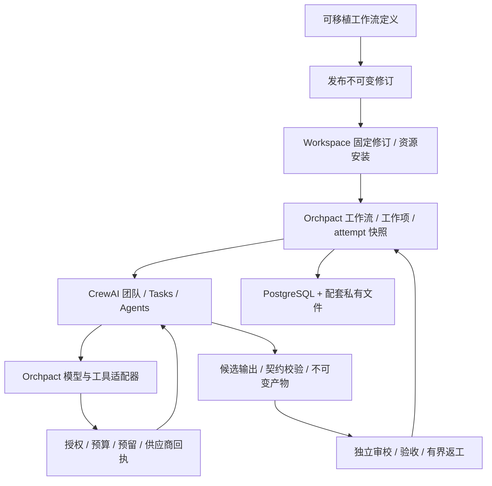

# Orchpact · 序契

**简体中文** | [English](README.en.md)

建议读音（美式）：**/ˈɔːrk.pækt/**，读作 **ORK-pakt**，重音在前。

**定义契约，执行协作，验证证据，验收交付。**

[官方网站](https://orchpact.github.io/) · [快速开始](docs/GETTING_STARTED.md) · [架构设计](docs/ARCHITECTURE.md) · [在线文档](https://orchpact.github.io/docs/)

**Orchpact 是一个开源、可自托管的契约驱动 Agent 工作流服务，使用 CrewAI 执行团队内的协作，由平台管理产物、验证证据与验收。** 作者声明团队、岗位、依赖、资源需求、交付契约和验收规则；使用者在自己的 Workspace 安装这些定义，绑定本地模型资源，再发起独立执行。

当前推荐使用固定执行计划与明确交付契约。产物通过了哪些检查，以该次声明和保存的证据为准；未配置业务验证的结构化输出不代表业务事实正确。自主规划、招募和动态分派保留为实验能力，不作为默认入门流程。组织关系、模板和组件继续服务于交付，不扩展为通用应用托管或运营平台。

工作流是可分享、可固定版本的资产。它可以交给不同的人、团队和应用使用；各自的账号、模型凭据、输入、运行、产物和账务由服务端隔离。

本项目以 **HTTP 服务、CLI、管理台和 Docker/Compose** 发行，Python wheel 是服务的安装载体。公开集成边界是工作流 JSON、HTTP API、平台会话、HTTP 客户端与 CLI。技术文档和实现位于本仓库；官网由独立的 [orchpact.github.io 仓库](https://github.com/orchpact/orchpact.github.io)维护。项目采用 [MIT 许可证](LICENSE)。

可以先运行 [不调用付费模型的四种交付验收场景](examples/README.md)，观察错误拒绝、修复和 INCONCLUSIVE。主流程直接运行工作流，无需创建子应用或签名网关。

```sh
uv sync --frozen
uv run python examples/verified-delivery.py
```

## 两层协作，一个持久化运行时



| 边界 | Orchpact | CrewAI |
| --- | --- | --- |
| 定义与安装 | 发布修订、Workspace 安装、资源与执行快照 | 按冻结的团队声明创建运行对象 |
| 协作推进 | 跨团队依赖、工作项、取消、重试与返工 | 团队内 Tasks 顺序推进、岗位上下文交接 |
| 自主行动 | 提供有权限、范围和额度限制的模型与工具 | Agent 选择工具、读取观察并进行多轮行动 |
| 事实与交付 | 保存调用回执、账务、产物及验收记录 | 返回待平台校验的候选结果 |

**长期复用的是团队声明，每次实际启动创建新的 Crew、Task 和 Agent。** 一个部门或小组可以对应一份团队声明，成员对应岗位声明；运行对象不跨项目、Workspace 或重试共享。当前采用声明顺序的 CrewAI 协作，团队内自主选择工具和多轮行动由 CrewAI 执行，跨团队业务图由 Orchpact 推进。

每次模型与工具调用都经过平台适配器。框架不能自行扩大权限、更换付款人或接受交付；CrewAI 的内部用量汇总不作为扣账依据。完整边界见 [职责矩阵与适配设计](docs/EXECUTION_BOUNDARY.md)、[团队声明与实例](docs/TEAM_EXECUTION.md)。

## 定义、安装、执行分别管理

| 动作 | 固定什么 | 后续修改的影响 |
| --- | --- | --- |
| 发布工作流 | 作者定义、目录修订和 SHA-256 | 不升级已有空间安装 |
| 安装到 Workspace | 工作流固定修订、组织实例和本地资源绑定 | 需显式预览、确认升级 |
| 发起执行 | 输入、来源、参与岗位、模型、付款人与规则快照 | 不被后续定义或配置修改回写 |

定义中的 `model` 是能力槽位；实际模型标识与凭据由使用方配置。导出定义不携带实例绑定、运行记录或密钥，作者仍需自行审阅提示词和业务 Schema 中的内容。协议见 [工作流与空间安装](docs/WORKFLOWS.md)。

## 从一个团队工作流开始

[department-review.json](examples/workflows/department-review.json) 是完整的可移植示例：

1. 分析团队的 `analyst` 核实原始记录，`writer` 根据团队上下文交付 `result.json`。
2. 独立审校团队的 `checker` 重新核算，使用当前产物 ID 提交 `audit.json`。
3. Orchpact 检查文件契约和审校引用；拒绝时在定义上限内定向返工，新产物必须重新审校。

报告需要“先选择来源、再撰写”的策略时，使用 [explicit-reference-report.json](examples/workflows/explicit-reference-report.json) 声明独立步骤；执行器不会根据引用规则隐式增加模型调用或改写输出 Schema。该示例只验证结构与引用约束，不证明事实或报告质量。

团队属于 `units[].crew`，节点通过 `participants` 选择本次参与岗位与顺序；团队内部协作不会额外生成业务工作项。示例的模型需求与使用方绑定分别保存：

```json
{"resources":{"models":{"reasoning":{"capabilities":["text","json"]}}}}
```

```json
{"models":{"reasoning":"your-text-profile"}}
```

第一段是定义中的资源需求片段，第二段是本地安装绑定文件；它们不混在一起。先在源码目录离线校验完整示例：

```sh
uv sync --frozen
uv run orchpact workflow-check examples/workflows/department-review.json
```

这一步不需要实例配置、数据库或模型。运行实例后，在管理台“工作流目录”发布定义，为当前 Workspace 选择 `department-review` 的明确修订，预览并安装模型绑定。

也可通过客户端发布并安装：

```sh
# ORCHPACT_API_TOKEN 从环境提供；本地绑定文件只填写资源标识。
uv run python examples/register-workflow.py examples/workflows/department-review.json \
  --install --bindings /absolute/private/bindings.json
```

在管理台工作流目录点击“直接运行”，或调用 `POST /api/v1/workflows/department-review/runs`，提交操作输入并附幂等键：

```json
{"operation":"calculate","input":{"records":[{"id":"source-a","amount":3},{"id":"source-b","amount":5}]},"context":{}}
```

实际执行消耗所配置模型的额度。`GET /api/v1/runs/{id}` 返回执行、产物与证据；跨 Workspace 的权限检查仍在服务端执行。详见 [直接运行工作流](docs/APPLICATIONS.md)。

需要先阅读更小的计算与审校定义时，可看 [evidence-review.json](examples/workflows/evidence-review.json)；两个示例共用同一工作流、产物与验收机制。

## 启动服务

### Docker Compose

仓库内提供服务、管理台和 PostgreSQL 的独立配置，从源码构建：

```sh
git clone https://github.com/orchpact/orchpact.git
cd orchpact
python3 docker/configure.py
docker compose --env-file docker/.env config --quiet
docker compose --env-file docker/.env up -d --build --wait
```

打开 `http://127.0.0.1:8780/admin/`。生成器将随机管理凭据保存到本机私有 `docker/.env`，不打印、不覆盖；操作者在本机读取 `ORCHPACT_API_TOKEN` 登录。端口占用时先修改 `ORCHPACT_PORT`。PostgreSQL 不开放宿主机端口，应用使用专用非超级用户。配置与数据卷的保留、备份和恢复见 [Docker 运行](docker/README.md)。

### Python 源码

要求 Python 3.11–3.13、uv 和专用 PostgreSQL 数据库；PostgreSQL 18 是当前验证与 Compose 使用的版本。

```sh
uv sync --frozen
uv run orchpact --root /absolute/private/orchpact-instance init
# 创建专用空库，在该实例 .env 中配置 ORCHPACT_DATABASE_URL。
uv run orchpact --root /absolute/private/orchpact-instance check
uv run orchpact --root /absolute/private/orchpact-instance serve --host 127.0.0.1 --port 8780
```

`init` 生成权限为 600 的私有配置，不打印凭据。没有模型也能启动管理面；执行前需要配置可用模型，并给执行账号分配额度，新账号默认 **0**。内部积分与供应商实际费用分别记录。连接配置见 [PostgreSQL 运维](docs/POSTGRESQL.md)，完整上手步骤见 [快速开始](docs/GETTING_STARTED.md)。

## 执行时必须成立的约束

- **行动受权**：每次模型或工具行动重新检查执行身份、attempt、能力、期限、预算和停止标志；上下级关系不自动授予委派或验收权。
- **额度有界**：默认每个 attempt 最多 12 个模型决策步骤、8 个工具步骤、300 秒和 128000 字符历史。团队成员、协议修正与同一 attempt 中再次启动的 Crew 共享额度；每次真实请求分别计费。
- **产物不可变**：交付文件保存身份与哈希，结构通过和专业验收分别记录；返工产生新代次，旧验收不能接受新产物。
- **验收不可削弱**：执行主体不能修改已受理计划；用户计划变更不能取消声明的检查、其输入或汇总路径，也不能删去已有验收依赖。修改验收要求需要新定义和新执行。
- **回执可恢复**：请求先预留、后按真实回执结算。未知 Token 不写成零，外部结果未知时保留预留，先恢复回执，不自动重放付费请求。
- **存储成对**：单个主进程独占 PostgreSQL 数据库及配套私有文件目录。业务、账务和审计在事务中提交，文件与回执按既有持久化协议保存，备份恢复包含两者。

### 当前实现范围

团队执行支持声明顺序协作、受控搜索和依赖产物读取；没有启用 CrewAI 的层级 Manager、自主跨成员委派、共享持久记忆或任意工具插件。图片生成通过平台图片提供者执行。

运行方式是单机、单主进程；并发工作由同一 owner 调度。当前不提供远程 Worker、多主高可用调度、通用异常分支语言、外部 Agent 适配或生成代码执行。取消和时限在行动边界检查，已发出的外部请求仍可能产生费用。更多限制见 [架构](docs/ARCHITECTURE.md)与 [公开接口](docs/COMPATIBILITY.md)。

## 验证机制

以下检查使用真实 CrewAI 和隔离 PostgreSQL，外部传输使用合成响应，不调用付费供应商：

```sh
uv run orchpact workflow-check examples/workflows/department-review.json
uv run python evals/verify_contracts.py --output /absolute/new/contracts.json
uv run python scripts/smoke_release.py --output /absolute/new/smoke.json
uv run python -m unittest discover -s tests -p 'test_*.py'
node --test tests/*.test.cjs
```

测试需通过 `ORCHPACT_PG_BIN` 指定本地 PostgreSQL 二进制目录，或配置有 CREATEDB 权限的专用 `ORCHPACT_TEST_DATABASE_URL` 与匹配的 `ORCHPACT_PG_DUMP`。不会使用业务 `ORCHPACT_DATABASE_URL`。验证输出文件必须不存在；结果用于证明权限、状态、回执与结算语义，真实模型质量、检索效果、性能和生产部署需独立验收。

## 文档导航

| 阅读目的 | 文档 |
| --- | --- |
| 启动并执行一个团队工作流 | [快速开始](docs/GETTING_STARTED.md) |
| 理解两层执行、快照与持久化 | [系统架构](docs/ARCHITECTURE.md) |
| 定义岗位、参与名单和团队交接 | [执行团队](docs/TEAM_EXECUTION.md)、[Orchpact / CrewAI 职责边界](docs/EXECUTION_BOUNDARY.md) |
| 发布定义、固定引用与安装资源 | [工作流协议](docs/WORKFLOWS.md)、[公共契约](contracts/README.md) |
| 接入应用、管理身份与费用 | [应用 API](docs/APPLICATIONS.md)、[Workspace](docs/WORKSPACES.md)、[提供者](docs/PROVIDERS.md)、[管理台](docs/CONSOLE.md) |
| 部署、备份与发行 | [Docker](docker/README.md)、[PostgreSQL](docs/POSTGRESQL.md)、[发行验收](docs/RELEASE_VALIDATION.md) |
| 参与维护与了解承诺 | [公开接口](docs/COMPATIBILITY.md)、[贡献指南](CONTRIBUTING.md)、[安全报告](SECURITY.md)、[仓库边界](docs/REPOSITORIES.md) |

对照评估方法见 [evals/README.md](evals/README.md)。包、配置与接口的公开名称见 [接口标识](docs/NAMING.md)。

品牌素材：[Logo、Icon 与头像 PNG](src/orchpact/static/brand/README.md)。
