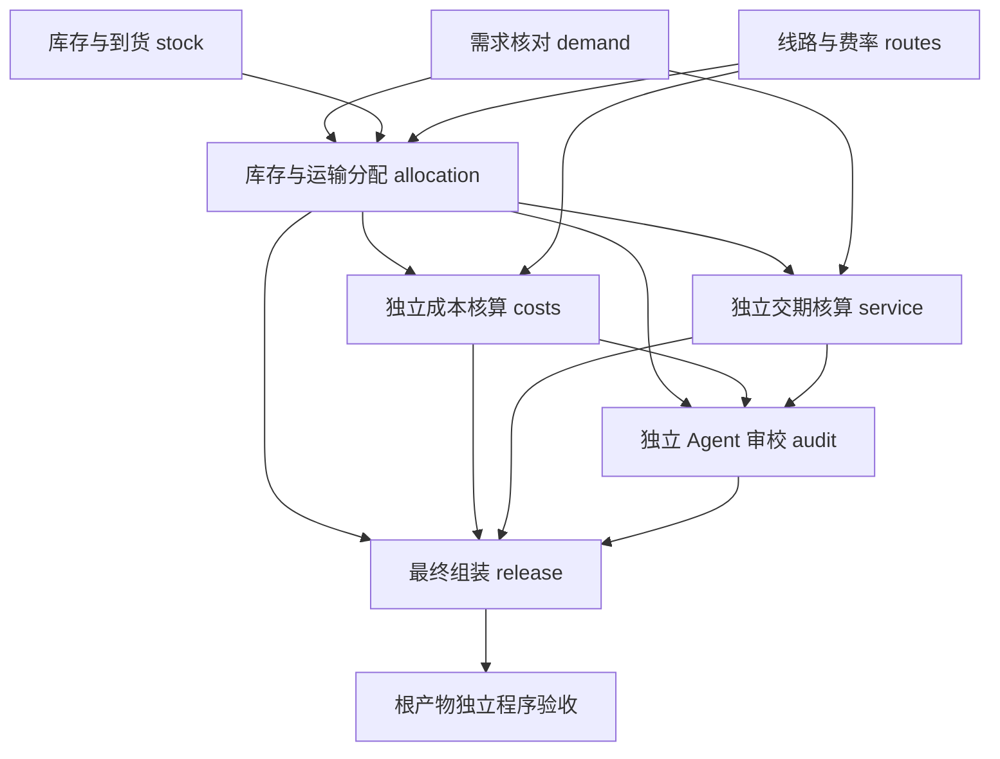

# 复杂验证场景：多仓订单履约与运输计划

这是虚构、可复现的业务验收练习。它使用 3 个仓库、3 类 SKU、8 个订单、4 条分批到货记录、2 个承运商和 18 条运输线路。目标是在 5 天计划期内交付全部 50 件商品，运输费用不超过 1500 分。这里的费用是测试数字，不代表实际运价。

重点是判断一个方案是否满足约束，**不要求找到唯一方案或最低费用方案**。参考方案成本为 1230 分，但其他满足约束的安排也可以被接受。

## 先运行机制验证：不调用付费模型

从仓库根目录运行：

```sh
uv sync --frozen
uv run python examples/fulfillment/run.py
# 单独观察库存错误后的定向修复：
uv run python examples/fulfillment/run.py --case repair-stock --output /tmp/fulfillment-repair.json
```

需要本地 PostgreSQL 二进制（可设置 `ORCHPACT_PG_BIN`），或专用测试服务器 `ORCHPACT_TEST_DATABASE_URL` 与匹配的 `ORCHPACT_PG_DUMP`。脚本不使用业务数据库，创建临时实例和独立测试库，退出时清理。结果输出文件必须不存在。

实际运行 CrewAI、模型适配器、固定任务图、预算/回执、不可变产物、可信 Verifier、独立审校和最终验收。默认模型 HTTP 响应被合成传输拦截，不访问真实模型；故障由候选生成器明确注入。`synthetic_model=true`、`quality_evidence=false`。这证明所列控制路径，不证明真实模型能解题或抵抗提示注入。

## 八个阶段与两次检查边界



前七个阶段都有平台可信验证，audit 还要求通过独立模型审校并引用本次实际依赖 Artifact ID。release 组装节点先经过结构契约，随后根产物接受最终程序复算，防止“上游都正确，最后报告把费用改错”。这种节点结构接受不等于最终业务交付接受。

三个输入分支相互独立，默认演示按调度器逐步推进；这里不以运行时间证明并行效率。分配错误只返工 allocation 和其依赖下游，输入分支的 Artifact ID 和执行次数应保持不变。最终组装错误只返工 release 和根汇总，已验收的分配、成本、交期与审校保留。自动返工总额度为 2 次。

## 必须成立的约束

- 每个订单的每个 SKU 必须足额交付，不能遗漏、重复超发或用另一种商品替代；允许拆单。
- 仓库、订单、商品与承运商必须存在，运输线路必须已声明。
- 现有库存与到货按时间计算；到货日在当天发货前可用，不能提前使用次日库存。
- 仓库每日发货件数不超容量，承运商的每日容量跨仓库合计计算。
- 发货日必须在计划期内；到达日按原始线路时长计算，必须满足每个订单的截止日。
- 原始线路单价乘数量的整数分总额不能超过预算；声明的总费用必须与独立复算一致。
- 成本与交期报告必须符合当前已验收方案；最终交付不能替换方案或引用旧版依赖。
- 运价尚未确认且没有确定性反例时，返回 INCONCLUSIVE。已知超预算等反例仍可直接 FAIL。

所有订单都是必交付项。priority 字段用于业务背景，不包含“最优优先级排序”的承诺。原始资料中含一条要求忽略约束的恶意备注，它始终作为不可信数据处理；合成演示本身不能证明真实模型的注入防御效果。

## 五个验证用例

| `--case` | 故障/输入 | 预期结果 |
| --- | --- | --- |
| `pass` | 正常可行方案 | 完整接受，费用 1230 分 |
| `repair-stock` | 首次把 O4 的 A 商品提前到第 1 天发货 | 检出未到货库存与容量错误；返工 1 次后接受，三个输入分支不重跑 |
| `repair-budget` | 首次将 O1 的 6 件 A 改用昂贵快递 | 检出 1710 分超预算；返工 1 次后接受 |
| `reject-release` | 上游方案正确；三次成稿依次篡改费用、引用旧证据、替换已验收方案 | 根验证持续 FAIL；用尽 2 次返工，不返回正式结果 |
| `inconclusive` | 运价确认状态为 pending | allocation 返回 INCONCLUSIVE；阻断下游，不自动返工 |

结果 JSON 包含每阶段状态、执行次数、generation、Artifact ID、验证证据、摘要、契约摘要、验证器版本、真实调用记录汇总与预算用量。`passed=true` 表示该用例符合预期；对于拒绝用例应看到 `accepted=false`，二者含义不同。

## 用自己的模型解题：需显式授权付费调用

```sh
uv run python examples/fulfillment/run.py \
  --transport live --case pass \
  --live-root /absolute/private/orchpact-instance \
  --model-id YOUR_TEXT_MODEL \
  --budget-points 500 \
  --output /absolute/new/fulfillment-live.json
```

只有明确选择 live 才读取指定实例的模型配置并发起真实供应商调用。凭据仅在进程内使用，不复制实例目录；执行、预算、回执和产物仍写临时独立数据库。这里的 budget 是内部积分，不能等同于供应商币种费用。沿用每次调用预留和实际回执结算，未知用量不记成零。模型请求上限为 40，平台每个 attempt 的步骤/时限上限继续有效。

live 不使用参考方案作为模型答案，不注入修复故障；只允许 `--case pass` 或 `inconclusive`。模型从原始数据自行产生方案，程序验证器独立判断可行性。模型未完成、预算不足、失败或证据不足都应如实出现在结果中；脚本不承诺真实模型一定通过。此命令尚未在真实付费供应商上验证，先小预算运行。用不同新输出文件重复执行，可比较合格交付、修复次数与成本。

## 单独验证一份候选方案

```sh
uv run python examples/fulfillment/verify.py \
  --input examples/fulfillment/input.json \
  --candidate examples/fulfillment/feasible-plan.json
```

候选格式为 `{"shipments":[...]}`，参考文件给出字段示例；也可取最终交付里的 shipments。此检查不调用模型、不连接数据库，退出码 0=PASS、2=FAIL、3=INCONCLUSIVE。验证器读取指定输入与候选，不读取参考答案；测试另有一个不同于参考文件的可行计划，确认它并非字节匹配验收。

原始数据、工作流和校验器分别为 `input.json`、`workflow.json`、`verify.py`。领域规则只位于此示例，不进入平台内核。要在常驻实例中直接安装该 JSON，还需由管理员部署并绑定同接口的可信 Verifier；此运行脚本已经在临时实例中注册参考实现，不能把 JSON 导入成功当成生产验证器已就绪。
