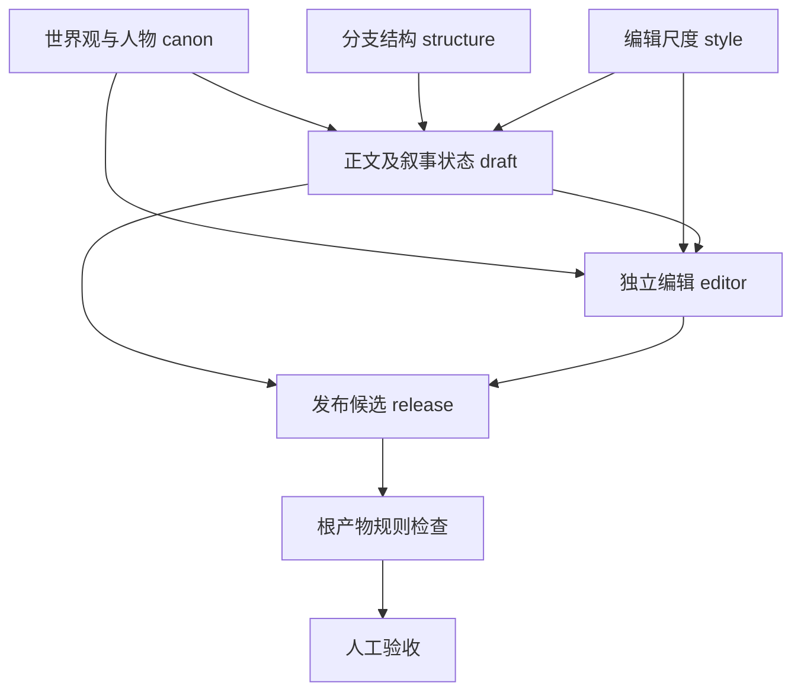

# 创作型复杂场景：互动悬疑短篇与独立编辑验收

委托：创作《闭馆后的第七声钟响》。暴雨封住旧馆，调查员林澈、守夜人沈禾和周馆长被困其中。停摆的机械钟、被改过的借阅登记、拼接的录音带构成三条线索。故事有四段共同情节和两个可选择结局：公开真相，或保全证据暂缓公开。

作者知道馆长的秘密，但人物只能在剧情中获得足够线索后知道它。两个结局都要回应已有线索，并体现不同的价值选择。交付包括实际中文正文、分支图、人物知情声明和编辑报告。

这里的主要难点是叙事连贯、悬念与审美判断。程序只能检查声明的状态，正文语义仍须编辑与人审。**程序 PASS 不会自动发布文稿。**

## 一条命令观察全部机制

```sh
uv sync --frozen
uv run python examples/mystery-story/run.py
# 先读一份候选文稿与编辑报告：
uv run python examples/mystery-story/run.py --case await-human --output /tmp/mystery-candidate.json
```

要求本地 PostgreSQL（可指定 `ORCHPACT_PG_BIN`），或专用 `ORCHPACT_TEST_DATABASE_URL` 和匹配的 `ORCHPACT_PG_DUMP`。默认合成模式创建临时独立实例和测试库，退出时清理；不使用业务库，不覆盖已有输出。候选正文保存在结果 JSON 的 `candidate_story`，编辑意见在 `editor_report`。

默认模型响应为合成数据，实际使用 CrewAI、不可变 Artifact、可信验证调用、返工、权限和验收服务。合成编辑报告不代表真正文学判断；`quality_evidence=false`、`semantic_status=NOT_VERIFIED`。

## 六个阶段与发布人审



三个准备分支相互独立。正文失败时只返工 draft 与下游，准备分支的产物和执行次数应保持不变。自动返工总额度为 2 次。

脚本在安装后、发起执行前，为独立 publisher 单元设置冻结的 `independent_review=true`，仅根汇总要求人审。写作与编辑单元不因此逐项等待人审。参考 Verifier 还检查根快照确实包含人审要求；忘记配置此策略会得到 INCONCLUSIVE。执行主体尝试自行接受根产物必须被拒绝。

`workflow.json` 本身不能代替治理策略。要安装到常驻实例，需要管理员部署并绑定同接口的可信 Verifier，并为 publisher 单元设置上述策略。合成模式的临时演示退出后不会留下可继续审批的在线项目；结果文件保留候选文稿，不能把它当成真实人审已完成。下文 live 模式会保留独立实例供后续审批。

## 能由程序检查什么

- 六个场景完整，所有分支存在，两个结局均可达，没有回环或非结局死路。
- 场景时间递增，地点、视角和人物保持固定约束。minute 为相对故事起点的分钟，不是墙上停钟的读数。
- 人物声明使用的线索必须已经获知；线索只在指定场景和人物处获得。
- 声明知道秘密前，必须满足线索前置条件和最早揭露时间。
- 每条路径引入的线索，都必须在该路径结局中声明回收。`payoffs` 只填写线索 ID，秘密 ID 使用 `learns_secrets` / `uses_secrets`；失败反馈会列出错误 ID 与当前路径的可用线索。
- 总正文为 800–3500 个 Unicode 字符（含标点，含两个结局），每场至少 80 字符。
- 两个结局正文不能完全相同；最终发布候选必须保留编辑审过的同一版正文和 Artifact 引用。
- 编辑必须逐条复制冻结秘密事实，并分别引用两个结局中的实际连续原文，给出 MATCH / MISMATCH / INCONCLUSIVE。程序核对事实原文、引用存在性、完整覆盖和版本绑定；MATCH 的语义判断仍来自模型。

这些检查无法证明隐喻、对话、人物动机合理，也无法保证“回收线索”的声明真的体现在正文。编辑评审属于模型辅助证据；最终负责人需要阅读实际文字。编辑指出事实不符或正文缺陷时，具体意见和场景位置传给作者；引用错误或覆盖不全则要求编辑修正报告，不能让作者为坏引用重写正文。

## 七个用例

| `--case` | 注入情况 | 应观察到 |
| --- | --- | --- |
| `await-human` | 声明与结构通过，编辑报告 APPROVE | 根产物待人审，accepted=false；执行主体不能自验收 |
| `repair-knowledge` | 第二场人物声明使用尚未知道的秘密 | 检出 knowledge_leak；定向返工 1 次，再停在人审前 |
| `repair-branch` | 首稿删掉通向 E2 的边 | 检出不可达分支；修复后两个结局可达 |
| `repair-editor` | 结构通过，但正文把馆长误写成守夜人；合成编辑拒绝 | 具体编辑意见传给 draft，定向返工后重审；三个准备分支保持不变 |
| `reject-clue` | 两个结局始终漏掉 C3 的回收声明 | 用尽 2 次返工，不能交付 |
| `editor-inconclusive` | 独立编辑表示无法确认语义连贯 | INCONCLUSIVE；不自动返工，也不发布 |
| `annotation-blindspot` | 声明全部合法，第一段正文却提前说出真相 | 程序状态检查仍 PASS；明确 NOT_VERIFIED，仍被人审门阻止自动发布 |

最后一个用例是有意展示的验证边界，不能称为系统已经自动检测出正文泄密。它用来检验“证据范围”和“验收权限”是否被正确区分，而不是掩盖规则覆盖不足。

## 只模拟一次用户审批动作

```sh
uv run python examples/mystery-story/run.py --case await-human --simulate-approval
```

此选项仅对指定的合成有效场景开放，演示有权限的用户接受当前版本后系统进入 completed。报告仍标记 `simulated_approval=true`、`real_human_review=false`，不作为真实文稿质量证据。它不会对已知正文盲区、编辑未决或持续失败用例开放，也不在 live 模式开放。

## 使用真实模型写作

```sh
uv run python examples/mystery-story/run.py \
  --transport live --case await-human \
  --live-root /absolute/private/orchpact-instance \
  --run-root /absolute/new/mystery-run \
  --model-id YOUR_TEXT_MODEL --budget-points 500 \
  --output /absolute/new/mystery-live.json
```

运行前从环境提供 `ORCHPACT_SCENARIO_DATABASE_URL`，指向你为本次场景准备的专用空 PostgreSQL 数据库；不可使用业务库。脚本检查 public Schema 为空，拒绝复用任何已有数据的库。`--run-root` 也必须是新目录。明确选择 live 才读取源实例模型配置并发起真实付费请求；模型凭据仅在进程内使用，不复制源实例或重写其数据。

live 的数据库、产物、回执、账务和待人审状态保留在专用库与新目录，退出不会删除；UNKNOWN 和未结算用量也保留供恢复，不能重新运行来冒充对账。临时管理 Token 仅写入新目录私有 `.env`，不会打印；模型密钥不写入该文件。内部积分不是供应商币种金额。模型请求上限 32，平台每 attempt 的限额继续有效。

可在脚本退出后使用 `uv run orchpact --root /absolute/new/mystery-run serve` 打开该独立实例的管理台，查看并真实验收根候选；如需继续生成或返工，要重新配置该实例的模型凭据。管理台启动端口由你选择，不与已有服务共用数据库或文件目录。

live 从原始世界观自行创作文稿，不把参考正文作为答案传入模型，也不注入合成故障。编辑可能拒绝或表示证据不足，模型也可能因预算或契约失败而无法交付，应如实看结果。2026-11-22 已使用开发配置中的 DeepSeek 模型进行真实调用，发现并修复了线索回收字段说明不清、规则失败反馈缺少错误 ID 和场景位置，以及编辑具体意见未传递给写作者的问题。

真实运行也暴露了模型编辑的漏判：一次自动检查全通过、停在人审前的候选，将“调换展品”弱化成“动过展品”，编辑却给出 APPROVE。阅读正文后发现该偏差，因此未正式接受该产物，并增加冻结事实逐条核对与正文引用。该案例证明人审边界的必要性，也说明不能把单次自动通过当成文学质量或语义正确性的保证。

还修复了编排层的返工上下文问题：上游缺陷原先同时追加到下游编辑的任务说明，编辑重审时可能把旧问题当作当前问题。现在只有被选中的修正节点接收具体返工要求，下游因依赖更新重跑并重新核验当前版本；旧证据和旧产物继续保留。

作者返工时现在还接收 `repair_candidate`，即本任务上一次不可变候选的有界内容及摘要。它明确不是当前已验收输入，不能跳过重新验证；这让作者能保留正确段落并修复局部问题，而不是只看到错误摘要后重新写整篇。

同日五轮开发调试累计 44 次真实模型请求、491,268 Token；各轮使用的代码修订不同，不能据此计算固定系统的成功率。最后一轮使用 6 次模型请求、60,155 Token，0 次返工，通过声明、引用和编辑检查，根产物停在待人审，执行主体自验收被拒绝。五轮没有未知或未结算请求，产物与证据摘要已核对，原始记录与数据库备份私下保留，不纳入源码分发。所有运行均未执行真实用户审批；最后候选第二结局对秘密采用含蓄表述，仍需负责人阅读判断。

本例中的 `passed=true` 只说明声明、证据与人审门的机制符合预期；始终保留 `quality_evidence=false`，真实文笔和语义质量需要你阅读候选与编辑意见后判断。编辑使用相同基础模型的独立调用，并不构成独立专家证据，仍可能误判或提出额外要求；不得通过放松原契约来迎合编辑，也不能把被拒绝的运行隐藏为成功。

## 单独核对自己的一份正文声明

```sh
uv run python examples/mystery-story/verify.py \
  --candidate examples/mystery-story/reference-draft.json
```

该命令不连接数据库或模型，0=声明检查 PASS，2=FAIL，3=INCONCLUSIVE。即使退出码为 0，输出仍明确 `semantic_status=NOT_VERIFIED`、`human_review_required=true`。验证器不读取参考答案，另一份不同措辞的正文也可以通过相同声明约束。
